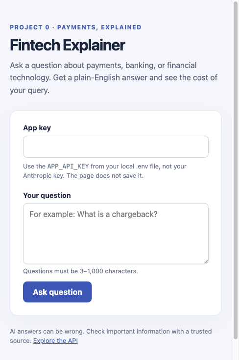

# Project 0: Fintech Explainer LLM App

A small FastAPI app that answers payment questions in plain English,
with a suggested source, a token counter, and a cost-per-query readout.

**What it demonstrates:** an end-to-end LLM application with an API,
structured output, evaluations, and Docker.



## How it works

- The browser interface uses plain HTML, CSS, and JavaScript; no Node.js is required.
- FastAPI serves the page and its JavaScript sends the question and app key to `/ask`.
- The API checks the key and rate limit, calls Claude, and returns the answer,
  suggested source, token usage, latency, and estimated cost.
- The source is a suggested source type, not a verified citation. Answers can be wrong.

## Setup (10 minutes)

```bash
python3.12 -m venv .venv
source .venv/bin/activate
python -m pip install -r requirements.txt
cp .env.example .env
# edit .env and add the Anthropic API key; never commit .env
```

Generate a separate app key with `python -c "import secrets; print(secrets.token_urlsafe(32))"`.
Put it in `.env` as `APP_API_KEY`; do not share it or commit it.

Set a $25/month spend limit in the Anthropic console first:
https://console.anthropic.com/settings/limits

## Run it

```bash
uvicorn app.main:app --reload
# open http://127.0.0.1:8000
```

Enter the `APP_API_KEY` from `.env`, then ask a fintech question.
The key stays in the page while it is open and is not saved by the app.
The API test interface is available at `http://127.0.0.1:8000/docs`.

Try it:
```bash
set -a; source .env; set +a
curl -X POST http://127.0.0.1:8000/ask \
  -H "Content-Type: application/json" \
  -H "X-API-Key: $APP_API_KEY" \
  -d '{"question": "What is network tokenization and why is it safer than giving a merchant a card number?"}'
```

Response includes: `answer`, `source`, `model`, `input_tokens`,
`output_tokens`, `latency_ms`, `cost_usd`.
The prompt asks the model to answer fintech questions and decline unrelated ones.
This is not a guaranteed restriction; check the evals for failures.
The current Anthropic API does not accept a temperature setting for this model.
For `/docs`, use **Authorize** to enter the app key.
`/health` does not require a key.
Never send the key over an unencrypted public HTTP connection.
`/ask` allows five authenticated requests per rolling minute, shared by all users.
Further requests receive HTTP 429 and a `Retry-After` header in seconds.
The count is in memory: it resets on restart and is separate for each process
or instance, so it is not a global limit across multiple instances.
It limits request frequency, not total spending; set an Anthropic spend limit too.

## Run with Docker

```bash
docker build -t fintech-explainer .
docker run --rm -p 8000:8000 --env-file .env fintech-explainer
```

Open `http://127.0.0.1:8000` for the app, or `/docs` for the API.

## Deploy on Render

Create a Web Service from this repository and select the Docker runtime.
Set `ANTHROPIC_API_KEY` and `APP_API_KEY` in the service's environment settings.
Optionally set `LLM_MODEL`; the container listens on Render's `PORT`.
Use `/health` as the health check path.
Never add `.env` or an API key to the repository.
Use a single process and instance for the in-memory rate limit; use shared,
persistent rate-limit storage before scaling to multiple instances.

## Evals

```bash
python -m app.eval
```

Runs the 23-question test set in `app/eval.py` and prints:
each answer, key facts to check, median latency, and total cost.
Score correct / wrong / hallucinated by hand. Then automate.
The eval runs in-process, so it does not use the HTTP app key or rate limit.

## Tests

```bash
python -m unittest discover -s tests -v
```

The access-control and rate-limit tests use fake Anthropic responses and make no paid API calls.

## Files

- `app/main.py`: FastAPI app, LLM call, structured output, cost calculator
- `app/index.html`: browser interface for asking questions
- `app/eval.py`: 23-question eval set + runner
- `app/pricing.py`: per-model pricing table (Nov 2026, update if rates change)
- `requirements.txt`: Python deps
- `Dockerfile`: `docker build -t fintech-explainer .` then run it
- `.env.example`: copy to `.env` and add the API key

## Cost control

- Default model is the cheap one: `claude-haiku-5-5` ($0.10 input / $0.50 output
  per 1M tokens, Nov 2026). Set `LLM_MODEL=claude-sonnet-5-5` in `.env` only
  for quality checks.
- Every `/ask` response shows its estimated cost.
- Running all 23 eval questions on Haiku is expected to cost well under $0.10 total.

## Next step after this works

Project 1 is RAG over public payments docs: same app shape, plus
retrieval, citations to document chunks, and Ragas / DeepEval evals.
